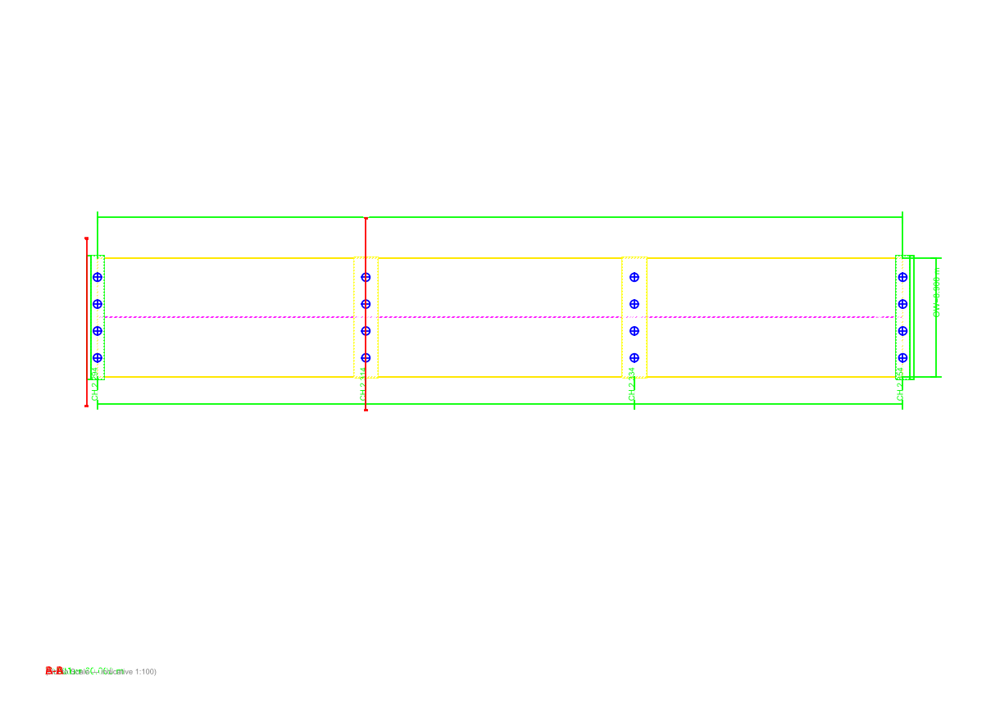
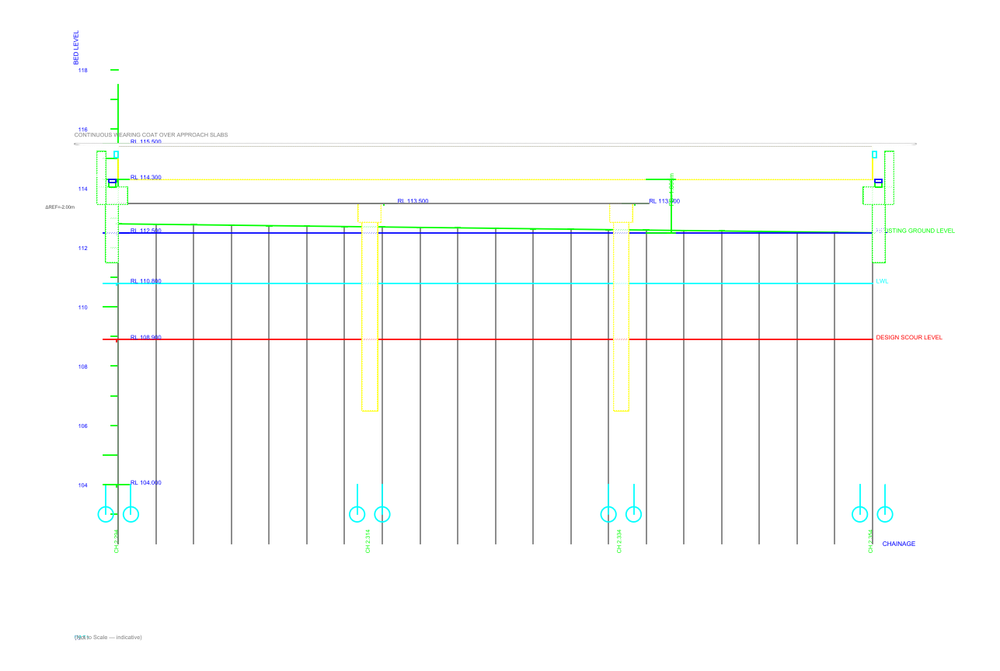
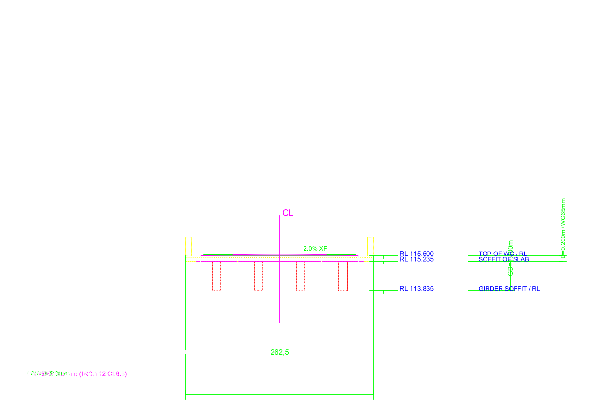
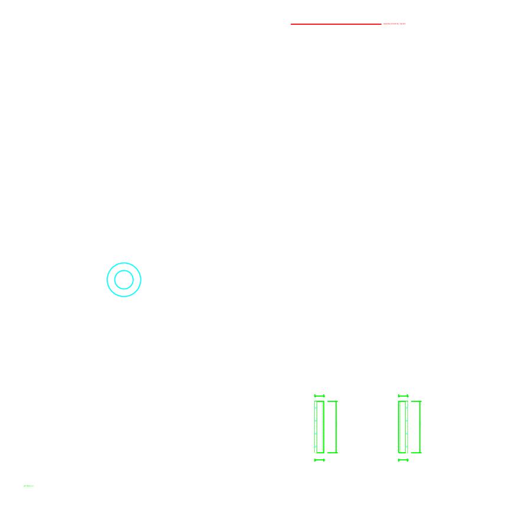
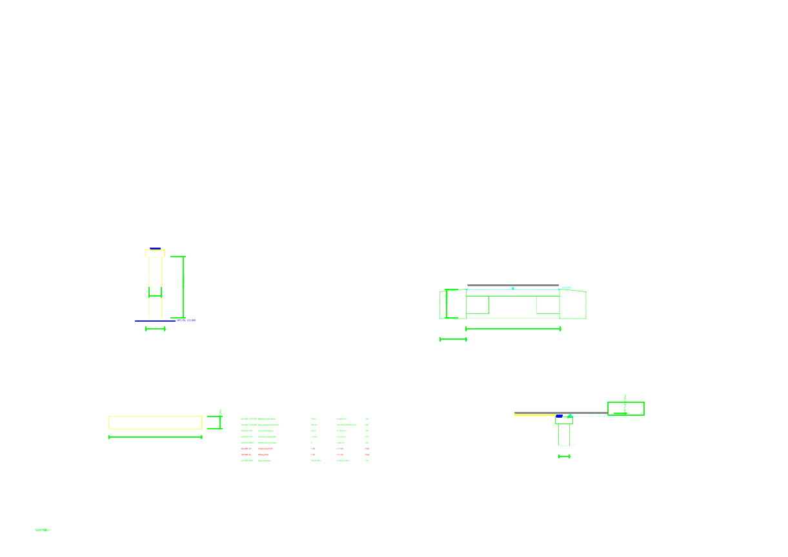
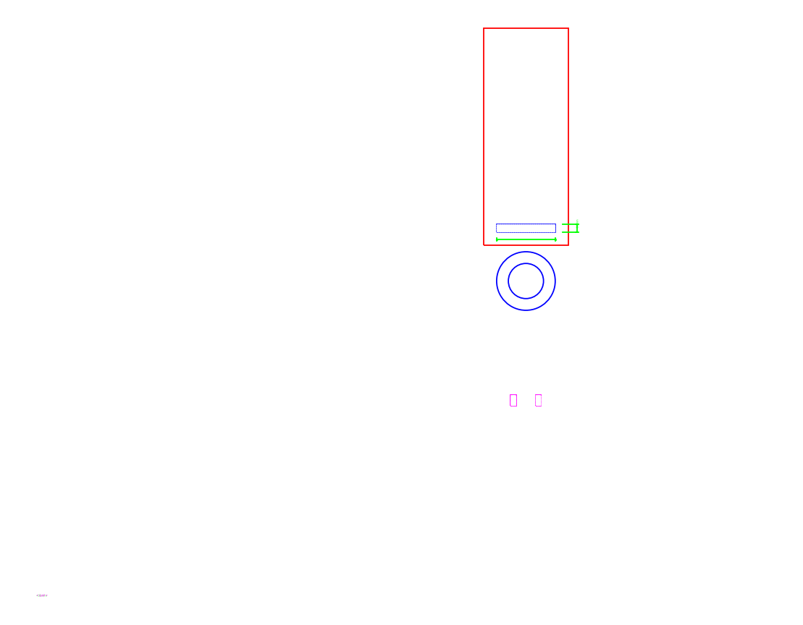
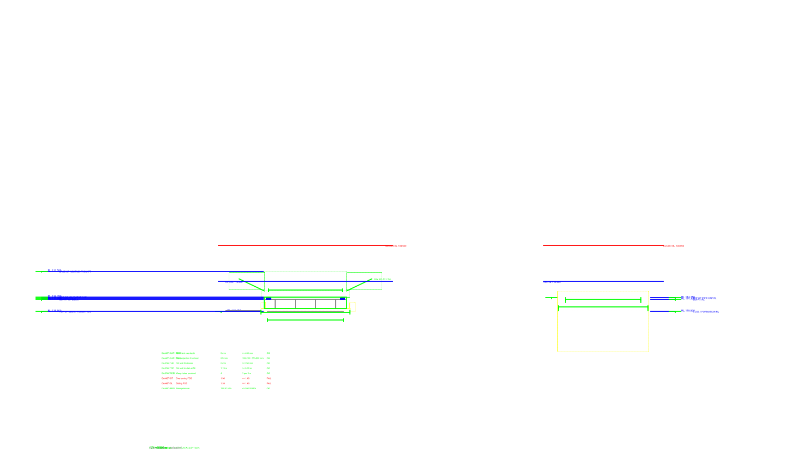

# Basantar Bridge (Well Foundation)

**Bridge:** MINOR-BRIDGE-CH2-300  
**Fixture ID:** `basantar_bridge_well`  
**Sheets generated:** 9 DXF  
**Rendered PNGs:** 9  
**PDF booklet:** [`basantar_bridge_well_GAD_Booklet.pdf`](basantar_bridge_well_GAD_Booklet.pdf) (2183 KB, 9 pages)  
**Total DXF size:** 662 KB  
**Standard:** IRC 5 / IRC 6 / IRC 21 / IRC 78 / IRC SP:55 / MoRTH 2024-25

## Sheets

| # | Sheet | DXF |
|---|---|---|
| 1 | Sheet1_Plan | `basantar_bridge_well_Sheet1_Plan.dxf` |
| 2 | Sheet2_LongSection | `basantar_bridge_well_Sheet2_LongSection.dxf` |
| 3 | Sheet3_CrossSection | `basantar_bridge_well_Sheet3_CrossSection.dxf` |
| 4 | Sheet4_Foundation | `basantar_bridge_well_Sheet4_Foundation.dxf` |
| 5 | Sheet5_PierAbutment | `basantar_bridge_well_Sheet5_PierAbutment.dxf` |
| 6 | Sheet6_BearingsJoints | `basantar_bridge_well_Sheet6_BearingsJoints.dxf` |
| 7 | Sheet7_BOQ | `basantar_bridge_well_Sheet7_BOQ.dxf` |
| 8 | Sheet8_SideElevations | `basantar_bridge_well_Sheet8_SideElevations.dxf` |
| 9 | Sheet9_Reinforcement | `basantar_bridge_well_Sheet9_Reinforcement.dxf` |

## Rendered previews

---
*Generated by BridgeCAD Enterprise Suite v0.1.0-rc1 — BRIDGECAD-OSS-1.0*
