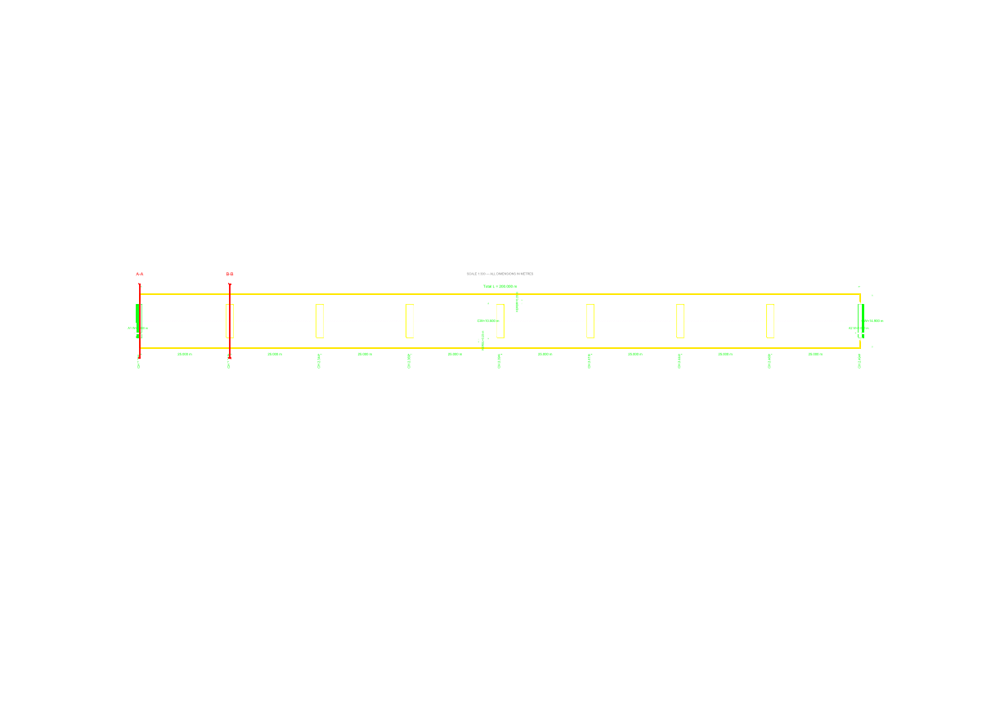
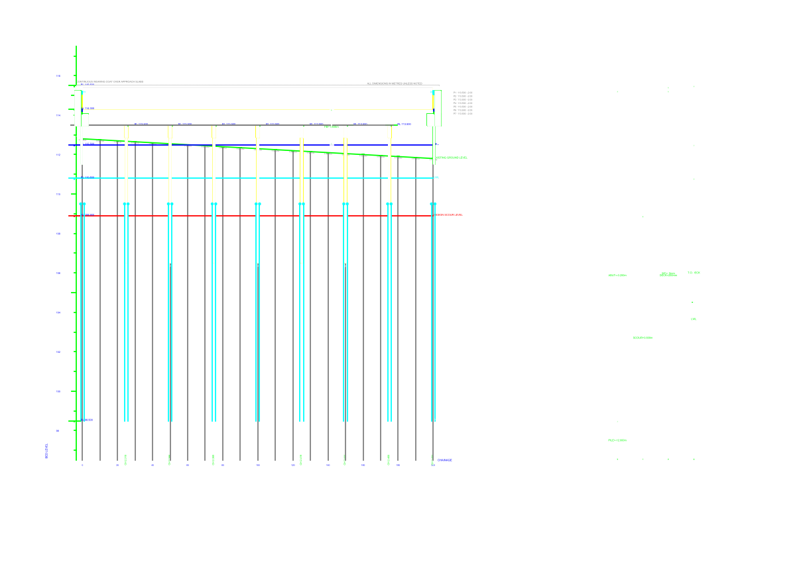
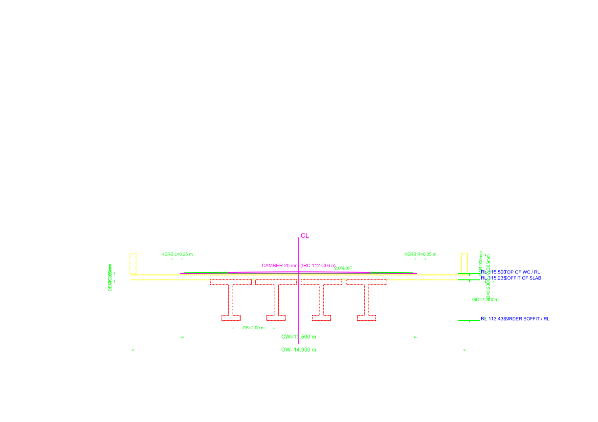
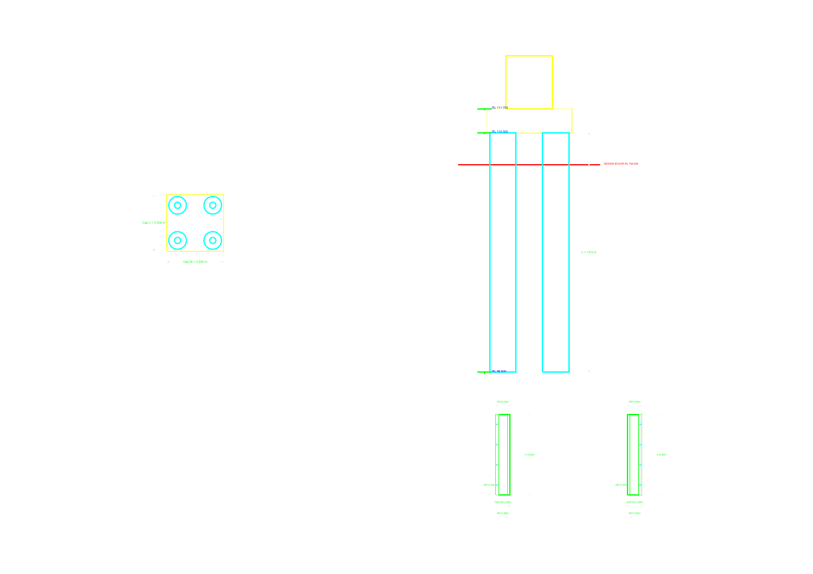
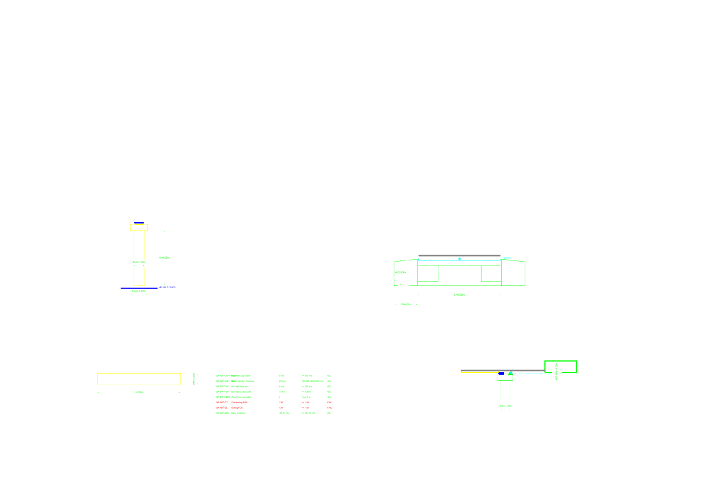
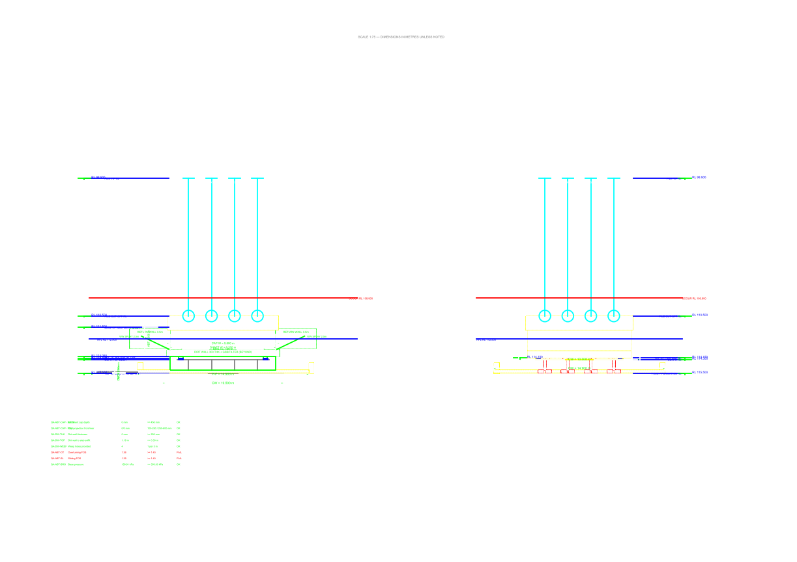

# Viaduct BR-187 CH 187+475

**Bridge:** MINOR-BRIDGE-CH2-300  
**Fixture ID:** `viaduct_br187_ch187_475`  
**Sheets generated:** 9 DXF  
**Rendered PNGs:** 9  
**PDF booklet:** [`viaduct_br187_ch187_475_GAD_Booklet.pdf`](viaduct_br187_ch187_475_GAD_Booklet.pdf) (2528 KB, 9 pages)  
**Total DXF size:** 875 KB  
**Standard:** IRC 5 / IRC 6 / IRC 21 / IRC 78 / IRC SP:55 / MoRTH 2024-25

## Sheets

| # | Sheet | DXF |
|---|---|---|
| 1 | Sheet1_Plan | `viaduct_br187_ch187_475_Sheet1_Plan.dxf` |
| 2 | Sheet2_LongSection | `viaduct_br187_ch187_475_Sheet2_LongSection.dxf` |
| 3 | Sheet3_CrossSection | `viaduct_br187_ch187_475_Sheet3_CrossSection.dxf` |
| 4 | Sheet4_Foundation | `viaduct_br187_ch187_475_Sheet4_Foundation.dxf` |
| 5 | Sheet5_PierAbutment | `viaduct_br187_ch187_475_Sheet5_PierAbutment.dxf` |
| 6 | Sheet6_BearingsJoints | `viaduct_br187_ch187_475_Sheet6_BearingsJoints.dxf` |
| 7 | Sheet7_BOQ | `viaduct_br187_ch187_475_Sheet7_BOQ.dxf` |
| 8 | Sheet8_SideElevations | `viaduct_br187_ch187_475_Sheet8_SideElevations.dxf` |
| 9 | Sheet9_Reinforcement | `viaduct_br187_ch187_475_Sheet9_Reinforcement.dxf` |

## Rendered previews

---
*Generated by BridgeCAD Enterprise Suite v0.1.0-rc1 — BRIDGECAD-OSS-1.0*
